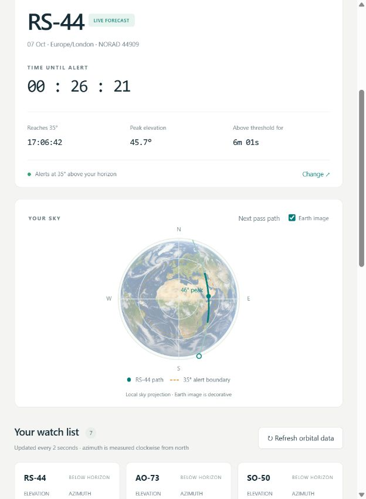
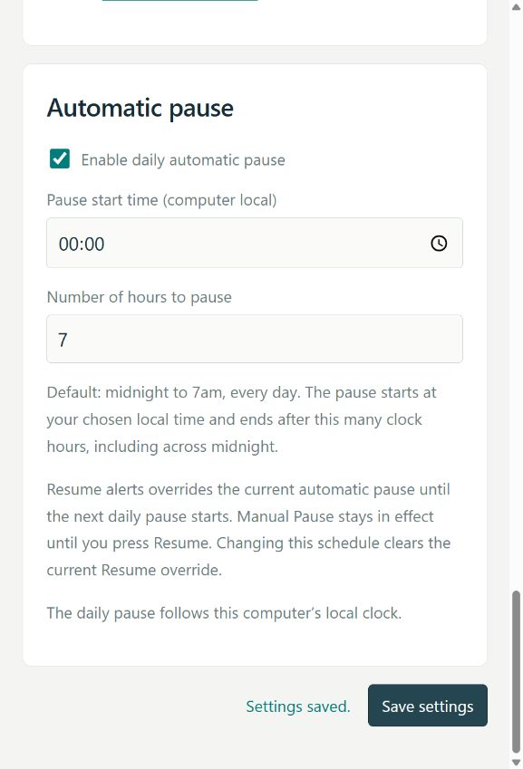

# Satellite Alert

A Python program with a local browser dashboard. It downloads
[AMSAT nasabare.txt](https://www.amsat.org/tle/current/nasabare.txt) every **24 hours**
and continuously checks the satellites' elevation from your ground station.



Satellite Alert shows live elevation, azimuth, distance and upcoming qualifying
passes. A local sky plot displays the selected satellite's path. Visual alerts,
Windows sound and optional popups warn when a pass meets your minimum elevation.
Choose an alert at the minimum angle, at horizon rise, or **5, 10 or 20 minutes
before rise**. The default is **5 minutes before horizon rise**. The Earth
background is shown by default and can be switched off in the live view.
All application text is at least **18px**, with larger headings and values.
The watch list puts the next predicted alert first. A daily automatic pause is
enabled by default from **midnight to 7am**, using your computer's local time.

Click the Earth to open a large, live **Earth map or local sky view**. All watched
satellites above the horizon appear, with the highest current elevation in gold.
Optional serial control points a **Yaesu GS-232B** rotator and independently
Doppler-tunes an **Icom IC-9700**. A main-page button starts and stops both.
**Test radio connection** alternates two VHF frequencies with a yellow progress
label. A failed rotator position reply leaves the radio's Doppler tuning running.
Settings provides a satellite editor with separate downlink/uplink frequencies,
modes and notes, plus detected COM ports and serial parameters.

The default ground station and satellite list are:

- Latitude **51.825° N** (`51.825`).
- Longitude **0.375° W** (`-0.375`).
- Minimum elevation **35° above your local horizon**.
- Alert **5 minutes before horizon rise**, only for passes reaching that angle.
- Automatic pause **00:00 for 7 hours**, every day.
- RS-44, AO-73, SO-50, ISS, FO-29, JO-97 and AO-123.
- Observer height defaults to **0 metres above sea level**; set your station's
  actual height in Settings. Existing saved preferences are retained.

## Start the server and open the application

Once installation is complete, start the Python server whenever you want to use
Satellite Alert. Run commands from the project folder containing
`satellite_alert.py`, `Start.cmd` and `README.md`.

### Windows: start with the launcher

Double-click **Start.cmd** in File Explorer. Alternatively, open the project
folder in PowerShell and run:

```powershell
.\Start.cmd
```

The launcher starts the Python server using the project's installed `.venv`
environment and opens the application in your default browser. **Keep its
terminal window open** while you want monitoring, alerts and equipment control
to run. If `.venv` has not been created yet, follow the
[installation steps below](#install-on-another-windows-computer) first.

### Start Python directly

On Windows, the equivalent command is:

```powershell
.\.venv\Scripts\python.exe satellite_alert.py
```

On macOS or Linux, after installing the dependencies:

```sh
.venv/bin/python satellite_alert.py
```

Choose one start method; only one server can use the same port at a time.
The server prints its dashboard address when it is ready.

### Open or reopen the application

On the **same computer running the Python server**, open your browser and visit
[http://127.0.0.1:8765/](http://127.0.0.1:8765/). Use this address if the browser
did not open automatically, or to reopen a dashboard tab you closed earlier.
The server must already be running for the page to load.

To start the server without opening a browser automatically, use:

```powershell
.\Start.cmd --no-browser
```

Or add `--no-browser` to either direct Python command above. Then open the
dashboard address yourself. If you need a different port, for example because
8765 is already in use, run:

```powershell
.\Start.cmd --port 8766
```

Then use [http://127.0.0.1:8766/](http://127.0.0.1:8766/). The direct Python
commands also accept `--port 8766`.

### Stop the Python server

Use either of these methods:

- **In the application:** open **How it works** in the left menu, scroll to the
  bottom and click **Stop app**.
- **In the server terminal:** click the terminal window that is running
  Satellite Alert and press **Ctrl+C**.

Both methods shut down the Python server and stop background monitoring,
orbital-data downloads, alerts and serial equipment control. The dashboard
will no longer receive updates until you start the server again.

**Closing the browser tab does not stop the server.** Similarly, **Pause alerts**
and **Stop live tracking** control those features while leaving the server
running. To restart after stopping the server, run **Start.cmd** or the direct
Python command again, then reopen or reload the dashboard. Live equipment
tracking starts off after a restart; press **Start live tracking** when ready.

## Install on another Windows computer

1. On [the repository page](https://github.com/uham999/SatelliteAlert), choose
   **Code → Download ZIP**. Alternatively, use the standalone `SatelliteAlert.zip`
   supplied with this project. **Extract all files** into a normal writable
   folder, such as a SatelliteAlert folder inside your Documents folder.
   Open the extracted folder containing `Install.cmd` and `README.md`.
2. Install the **Python Install Manager** from
   [python.org](https://www.python.org/downloads/). Open a new terminal and run
   `pymanager install 3.14` to install Python 3.14. With the new manager,
   `py install 3.14` also works unless an older Python launcher takes precedence.
   If Python 3.14 is already installed, skip this step. The installer accepts
   Python 3.12 or later; this project has been tested on 3.12 and 3.14.
3. In the extracted folder, double-click **Install.cmd**. Internet access is needed. It creates a local
   `.venv` and installs **Skyfield 1.55** plus its dependencies: NumPy, sgp4,
   jplephem and certifi, and **pySerial 3.5** for equipment control. No separate
   sound library is needed on Windows. Run Install.cmd again to add new
   dependencies when updating an existing installation.
4. Once installation says it is complete, press a key to close its window.
   Double-click **Start.cmd**. Your browser opens at
   `http://127.0.0.1:8765/`. Keep the program's terminal running.
5. Click **Settings** to check your location, height, satellite list and alert
   preferences. Click **Test alert** to check your speakers and the banner.

Python's [Windows installation documentation](https://docs.python.org/3/using/windows.html)
explains the install manager and virtual environments.

Both `.bat` and `.cmd` are Windows command scripts and run through `cmd.exe` on
Windows 11. `.cmd` is provided as the main launcher; the original `Install.bat`
and `Start.bat` call the same scripts and still work. No administrator access is
needed when you extract to a folder you can write to. Do not run from inside
the ZIP or open the scripts in Python/IDLE.

Alternatively, open the extracted folder in File Explorer, right-click its
background and choose **Open in Terminal**. In PowerShell, run `.\Install.cmd`,
wait for completion, then run `.\Start.cmd`.
The `.\` prefix tells PowerShell to use the file in the current folder.

The installer prefers Python 3.14, falls back to an installed Python 3.12 or
later, and keeps an existing `.venv`. It prints the environment's actual Python
version. To move an existing installation to Python 3.14, extract the ZIP into
a fresh folder and run Install.cmd there; copy your settings.json if desired.
Advanced users can select an interpreter with `.\Install.cmd "C:\path\to\python.exe"`.

The equivalent manual PowerShell commands, from the extracted folder, are:

```powershell
py -3.14 -m venv .venv
.\.venv\Scripts\python.exe -m pip install -r requirements.txt
.\.venv\Scripts\python.exe satellite_alert.py
```

If port 8765 is already in use, launch with `--port 8766` and use the new address.
The dashboard only listens on this computer; it needs no cloud hosting/account.
Your coordinates stay in local settings and are not sent to AMSAT.

## macOS or Linux

Install Python 3.12 or later. On Linux, install your distribution's Python venv
package if `python3 -m venv` requests it. From the extracted folder:

```sh
python3 -m venv .venv
.venv/bin/python -m pip install -r requirements.txt
.venv/bin/python satellite_alert.py
```

On these systems, keep the browser dashboard open and click **Enable browser
sound** or **Test alert**. Browser audio requires a button click after each tab
is opened or reloaded. Background tab throttling can delay browser-only sound;
Windows plays a bundled WAV chime through Python independently of the browser.
Browser sound is also available on Windows as an additional sound source.

## Alerts and the 35° angle

**Elevation is measured above the horizontal plane at your saved ground
position.** The geometric horizon is 0° and directly overhead is 90°.
Predictions use a WGS84 observer and SGP4 through
[Skyfield](https://rhodesmill.org/skyfield/earth-satellites.html). Atmospheric
refraction, local buildings, trees and terrain are not modelled.

By default the app alerts **5 minutes before horizon rise**, if the pass reaches
**35°**. Settings also offers **10 or 20 minutes before horizon rise**, **at
horizon rise**, and **when the satellite reaches the minimum elevation**. The early
options alert while the satellite is still below your local horizon. All five
timings retain the minimum predicted peak elevation requirement. Every pass in the table reaches the minimum.
It shows the selected alert time, horizon rise, the 35° crossing, peak time/elevation
and descent below 35°. The early alert date can be the previous day for a pass
rising shortly after midnight.
Time display can be switched between the computer's local time zone and UTC.

The **Earth image** checkbox in **Your Sky** switches the optional background on
or off immediately and saves your choice. This is the only Earth control; there
is no duplicate in Settings. The enlarged circle fills the available plot width.
The background is enabled for a new installation. The
image is decorative: the path still represents azimuth and elevation in your
local sky, rather than an orbit drawn over a geographical Earth map. Switching
the background does not silence an active alert or recalculate orbital data.
The transparent PNG is bundled locally, so it does not require a network
connection. It was created with the built-in ImageGen tool; its final prompt is
in `static/earth-overlay.prompt.txt`.

A real alert gives you:

- A large pulsing amber banner, with a reduced-motion alternative.
- A Windows chime, repeated every 30 seconds until acknowledged or the useful
  window ends. Automatic acknowledgement defaults to **60 seconds (1 minute)**.
  You can change/disable the sound or choose manual acknowledgement in Settings.
- A Windows popup, enabled by default, that can appear over other applications.
  Press OK to close the message, then acknowledge the alert in the app. You can
  disable the popup in Settings.
- Optional browser desktop notifications, enabled by your button click and your
  browser's permission decision. They are additional to the Windows popup.

**Test alert** is clearly labelled TEST. It plays the chime and shows the dashboard
banner using your automatic-acknowledgement duration, without opening a Windows
popup. In manual mode the test's sound ends after 60 seconds. Acknowledging silences
it immediately. A paused app still permits an explicitly requested test. The button
also enables browser audio for that tab, including on Windows. The dashboard reports
when the browser blocks audio instead of claiming that sound is enabled. The
**Play an audible alert** setting still controls both alert sound sources.

In **Settings → When to alert**, **Automatically acknowledge alarms after the
duration below** is checked by default. Set **Alarm duration before automatic
acknowledgement (seconds)**; the default is **60**, and the range is 1–86,400.
Each alert has its own deadline measured from its first notification. Repeat
chimes, another overlapping pass, pauses and restarting the server do not reset
it. The Python server applies the deadline even with the browser closed; its
2-second monitoring cycle can add up to about 2 seconds before acknowledgement.
If the server is stopped, an overdue alert acknowledges when it next starts.

Automatic acknowledgement silences repeat chimes, closes the in-app banner and
its Windows popup, and keeps the record in **Alert history** as **AUTO
ACKNOWLEDGED**. Open browser notifications close when the dashboard next receives
the acknowledgement. A pass that was acknowledged does not alert again.
**Acknowledge & silence** can end an alarm earlier. Changes to the duration or
automatic/manual option apply to pending alarms from their original start time;
shortening it past an alarm's age acknowledges that alarm immediately.

Uncheck automatic acknowledgement for the previous manual behavior. Real alerts
then stay in the app banner until you press **Acknowledge & silence**, including
after closing a Windows message, pausing alerts or the pass ending. The banner
appears above every app page. **Alert history** also has an **Acknowledge** button
for each unacknowledged entry. Clicking a browser desktop notification opens the
live dashboard. An expired manual alert remains available to acknowledge, but
its chime and notifications stop when its useful window ends.

**Set Windows volume and unmute before each alarm chime** is enabled by default
in Settings. Choose **Windows alarm volume (%)** from **1 to 100**. The initial
value is **100%**, preserving the previous full-volume setting; choose any lower
level you prefer. Immediately before native playback, the app sets the default
multimedia playback device to that level, unmutes it and checks the readback using
[Windows Core Audio](https://learn.microsoft.com/en-us/windows/win32/api/endpointvolume/nf-endpointvolume-iaudioendpointvolume-setmastervolumelevelscalar).
This applies to real alerts, repeat chimes and Test alert. The device remains at
the chosen level until you change its volume. Disable the setting to keep your
current volume and mute state. On other platforms the system volume is unchanged.
Volume changes do not acknowledge alerts or recalculate passes. If the
device cannot be controlled, the chime still plays at the current volume and the
sound status reports the volume error. No additional Python library is needed.

The Python monitor checks every **2 seconds**. It alerts once per satellite pass,
including a pass already underway at startup/resume. In early mode, starting
within the selected 5-, 10- or 20-minute warning window also catches the approaching pass. Alert history and pass
deduplication survive restart. Small time changes after a TLE refresh do not
produce a second alert for the same pass. Pausing stops real alerts and repeat
sound; resuming catches a currently qualifying pass.

## Daily automatic pause and manual control

In **Settings → Automatic pause**, choose whether to enable the daily pause,
its **start time**, and the **number of hours to pause**. The default is enabled:
start at **00:00**, pause for **7 hours**, and resume at **07:00**. A start of
22:30 with 8 hours resumes at 06:30 the next day. Fractional durations are allowed
from 0.25 to 24 hours. With 24 hours selected, each daily pause lasts until the
next start time.

The schedule follows the **computer running Python's local clock**, even if you
choose UTC for the pass table. It uses local clock hours, so midnight to 7am still
ends at 7am when daylight-saving changes the clock. Positions, forecasts and
orbital downloads continue during both automatic and manual pauses. Notifications,
new alerts and repeat chimes are suppressed. Existing messages stay available to
acknowledge in the app until their automatic deadline, or until you acknowledge
them manually. An explicit **Test alert** remains available. A pause alone does
not close an already open Windows popup; acknowledgement closes it.

Whenever either kind of pause applies, the dashboard displays:
**“Alerts are paused. Positions and orbital data continue to update.”**

- **Resume alerts** during an automatic pause overrides that period. Alerts stay
  active until the **next daily pause starts**, unless you manually pause again.
- **Pause alerts** applies a manual pause until you press **Resume alerts**, even
  after the automatic pause period ends. Manual Resume also overrides any
  automatic period currently in progress.
- Manual pause and the current Resume override survive an app restart. Changing
  the automatic pause schedule clears its Resume override and applies the new
  schedule immediately. It preserves an existing manual pause.
- Resuming catches an unalerted pass whose useful alert window is still open.
  Completed passes do not produce delayed alerts; acknowledged passes stay silent.

The watch list sorts by each satellite's **next unalerted qualifying pass**, with
the earliest predicted alert first. Satellites without one in the forecast go
last. Satellites with individually paused notifications follow those with
notifications enabled. Equal alert times retain the configured satellite order.
The global Pause alerts control does not change predicted times or the order.

Pause controls apply immediately when saved, without recalculating or
acknowledging an existing pass alert.

In **Settings → Satellites & frequencies**, each satellite has a **Pause
notifications until I uncheck this** checkbox. Checking it saves immediately and
silences that satellite's chimes, Windows popups, browser notifications and
dashboard alert banner until you uncheck it, including after restarting the app.
Other satellites continue to alert. Existing alerts remain in history for
acknowledgement. Positions and predictions continue updating, and notification
pauses leave live radio/rotator tracking running. New satellites start with this
box **unchecked**. You can also set it in the satellite editor.



## Enlarged Earth and sky views

Click the Earth in **Your sky**, or **Expand live view**, to open the larger view.
The default **Earth** mode is an orthographic globe centred on your saved station.
It plots each satellite's calculated WGS84 latitude/longitude at the point on
Earth directly beneath it. The purple cross marks your ground station. Select
**Your sky** to see the local azimuth/elevation plot instead. Both show every
watched satellite above the horizon and update every **2 seconds**. The highest
current elevation has a larger gold marker and is first in the expanded list.

The optional image behind the compact/local sky view is decorative. The geographic
Earth view uses bundled Natural Earth coastlines, so it works without a map
service or an internet connection after orbital elements have been downloaded.
Use **Close expanded view** or Escape to return to the dashboard.
The expanded Earth uses darker green land and coastlines, with a white outline
and label background keeping the purple ground station visible.

## Rotator and IC-9700 setup

New installations have both **Enable rotator control for live tracking** and
**Enable radio control for Doppler adjustments** **unchecked** in Settings.
Notification-only operation needs no radio or rotator. Positions, pass predictions,
frequency previews and alerts continue with both controls disabled. Existing
saved device choices, ports and baud rates are retained when upgrading.
The distribution includes `settings.example.json`; the program creates
`settings.json` on first launch. Keep your existing `settings.json` and `data/`
when upgrading to retain your station settings and alert history.

Enable the devices you want to use and save Settings. The devices are independent:
choose radio only, rotator only or both. The main **Start live tracking** button
becomes available when at least one device is enabled. Live equipment control
also starts **off on every program launch**. Press **Start live tracking** at the
top of the live page to begin. Press
**Stop live tracking** to send the rotator stop command and close both serial
connections. You can enable the radio, rotator, or both in Settings.

1. Connect your interfaces. Unset radio settings default to **COM6 at 57600 baud**.
   An unset rotator port selects **COM3 if detected**, with **9600 baud** by default.
   Existing saved ports and baud rates are retained, including an already saved
   9600 radio baud rate. If the radio already uses COM3, it is not also assigned
   to the enabled rotator. In Settings, use **Refresh available serial ports**, select
   the detected port for each enabled device, and save. The two enabled devices
   need different ports. The app lists ports without opening them; no equipment
   is commanded until you start live tracking or explicitly test a connection. Close other software using those
   ports first.
2. For the **GS-232B**, the default is **9600 baud, 8N1**. Match the controller's
   baud rate and azimuth travel configuration. Travel defaults to **360°**; choose
   **450°** only for an appropriately calibrated controller. In that mode the app
   chooses a nearby overlap bearing when available. It sends combined
   `Waaa eee` commands only after azimuth or elevation changes by at least **1°**
   from the last command. Circular azimuth comparison handles north correctly.
   A `C2` position query runs on connection and at most every 5 seconds thereafter.
   The dashboard distinguishes satellite direction, last command and reported
   antenna azimuth/elevation. [Yaesu GS-232B manual](https://www.yaesu.com/jp/manuals/yaesu_m/GS-232B_EAA14X002_1803E-AS-1.pdf).
3. For the **IC-9700**, select your CI-V interface port. The default is **57600 baud,
   8N1**, radio address **A2 hexadecimal** (162 decimal), controller address E0.
   Match the radio's CI-V baud and address. **19200** is also offered for REMOTE
   interfaces, and **9600** remains available. Higher USB CI-V rates such as
   **57600/115200** require the USB baud setting unlinked
   from REMOTE; select the virtual COM port carrying CI-V data. Your existing
   REMOTE USB interface handles TTL conversion.
4. On the radio, set **USB SEND off** and **AFC off**, and clear RIT/ΔTX offsets.
   Avoid manual tuning while the PC adjusts the two frequencies independently.
   NOR/REV controls tracking when turning the radio's main dial; the manual does
   not list an off option for NOR/REV. The app enters satellite
   VFO mode for duplex profiles, sets **MAIN for downlink/RX** and **SUB for
   uplink/TX**, sets each mode, and restores MAIN selection. On the first update
   for each satellite, it reads the actual MAIN/SUB bands after entering the
   appropriate mode. If the required downlink band is on SUB, it exchanges the
   bands before setting the frequencies. This also handles returning from the
   VHF connection test to a UHF-downlink pass and handovers between VHF/UHF
   satellites. The IC-9700 cannot assign the same band to MAIN and SUB; attempting
   to tune MAIN onto SUB's band can cause rejection **05 (FA)**.
   Leave a satellite's
   uplink blank for receive-only VFO tracking. Set required **CTCSS tones** on
   the radio yourself. The app changes tuning/modes and **does not key PTT**.
   [Icom CI-V reference guide](https://www.icomfrance.com/uploads/files/produit/not-IC-9700_ENG_CI-V_3a-en.pdf).
   [Icom basic manual, satellite operation](https://icomuk.co.uk/files/icom/PDF/productManual/IC-9700_ENG_Basic_0.pdf).

Tracking covers the **whole pass above the horizon**, including below your 35°
alert angle. With overlapping passes, the satellite with the **highest current
elevation** controls both devices; its predicted peak is not used to choose it.
Settings also offers tracking only above your minimum angle. Pausing alerts
affects notifications; use the separate live-tracking button to stop equipment.
Changing equipment, location, tracking criteria or satellite profiles stops live
control so you can restart after reviewing the changes.

Losing the target stops the rotator and waits for the next satellite. Observations
older than 6 seconds are rejected. A **rotator error**, including no valid **C2**
position reply, stops and disconnects the rotator while the enabled radio
continues updating both downlink and uplink for the selected satellite. The
equipment panel displays the separate rotator error. It does not repeatedly
reopen the failed port; **Stop live tracking**, then **Start live tracking** to
retry it. With only the rotator enabled, that failure stops live control.
Radio errors, command rejections and incorrect frequency readback stop live
control and display an error. It stays off until you correct the issue and start
it again. If the
connection is lost, the app cannot guarantee delivery of the stop command; a
failed stop is reported for action at the controller.

The moving **Calculated downlink / RX** and **Calculated uplink / TX** values are
orbital predictions. They continue updating while live control is off. The
equipment panel separately shows **Last verified RX/TX**, their radio readback
time and satellite, and the number of confirmed pass-frequency updates. Serial
failures appear prominently at the top of the dashboard. After a failure, correct
the issue and press **Start live tracking** again; calculated values alone do not
mean the radio has tuned.

## Test the rotator connection

Press **Test rotator connection** at the top of the live monitor. It sends one
`C2` command, terminated by carriage return, using your **saved rotator port and
baud rate**. It works independently of the rotator's live-tracking enable
checkbox and alert pauses. An unconfigured or unavailable port produces a
visible warning without sending a command.

The result panel shows the **test date/time**, port, baud, **raw C2 reply** and
decoded azimuth/elevation when valid. Times follow the dashboard's local/UTC
selection; `\r` and `\n` make the reply's line endings visible. No response within
0.8 seconds, a malformed reply, or a serial error is reported in the same panel.
Replies such as `AZ=183EL=010\r\n` are valid: the space between the azimuth and
elevation is optional. Both the connection test and live tracking accept them,
as well as spaced replies and the older `+aaaa+eeee` format.
The last result remains visible across dashboard refreshes until another test
or a program restart.

During live tracking, the query shares the existing rotator connection and is
serialized with other equipment commands. It preserves live tracking and radio
updates. Otherwise it opens the configured port for the single query and closes
it afterwards. The query does not command movement or restart a rotator stopped
after an error; use **Stop live tracking**, then **Start live tracking** to retry
live control after correcting the problem. A port currently used by radio
control cannot also be used for the rotator test.

## Test the radio connection

Press **Test radio connection** on the live monitor. It uses the saved radio
COM port, baud and CI-V address, selects the MAIN VFO and alternates
**145.000 MHz** and **145.555 MHz** every **2 seconds**. If VHF is currently on
SUB, it exchanges the bands onto MAIN before tuning. Each change requires a
CI-V acknowledgement and matching frequency readback.

The button changes to **Stop test radio connection** and a yellow label shows
**Radio connection test in progress**, including the confirmed MAIN frequency.
Press the button again to stop and close the port; the radio stays at its last
test frequency. Missing replies, rejected commands and incorrect readback stop
the test and display the error.

The test works without a visible satellite, independently of alert pauses and
the radio's live-tracking enable checkbox. Starting it stops live tracking and
the rotator. Stop the test before starting live tracking again. No PTT or
memory-write command is sent. The Python process runs the timing, so closing
the browser does not stop it; restarting the program always starts with both
the test and live tracking off.

## Satellite frequencies and Doppler correction

In **Settings → Satellites and frequencies**, use **Add satellite**, **Edit**,
**Save satellite** and **Remove**. Each entry has a name/NORAD number, separate
base RX/downlink and TX/uplink frequencies in **MHz**, modes and notes. These
edits save immediately. The watch list must retain at least one entry. A new
custom satellite must also be present in the AMSAT orbital feed to be tracked.
Leave RX blank for rotator-only operation, or TX blank for receive-only tuning.
IC-9700 duplex profiles must use different supported radio bands.

When adding a satellite, enter its name and pause briefly or move to the next
field. The app automatically looks up the downlink, uplink, receive mode and
transmit mode in AMSAT's [FM](https://www.amsat.org/live-fm-satellites/) and
[linear](https://www.amsat.org/live-linear-satellites/) frequency tables. The
**Look up frequencies & modes** button retries the lookup. A NORAD number works
when its identity can be resolved from the orbital feed or the built-in catalogue.
Exact names and published aliases are matched; similar names are not guessed.
Linear profiles use the centre of each passband. If more than one operating
profile is published, select one in **Operating profile** before using its values.

Lookup results include the source and remain editable before **Save satellite**.
Fields you enter manually are preserved if a lookup finishes later. No match or
an unavailable lookup displays a message asking you to enter all four values
manually. You can still save the satellite. The seven bundled references below
are an explicitly labelled fallback when their live source is unavailable.
Lookups require internet access; successful tables are cached for 24 hours, and
unavailable tables are retried after a minute or when the app restarts. Lookup
does not prove that the transponder is currently operating or save settings
until you press **Save satellite**.

These starting values were checked against AMSAT's
[linear](https://www.amsat.org/live-linear-satellites/) and
[FM](https://www.amsat.org/live-fm-satellites/) tables on 8 October 2026:

| Satellite | Downlink / RX MHz | RX mode | Uplink / TX MHz | TX mode |
| --- | ---: | --- | ---: | --- |
| RS-44 | 435.640000 | USB | 145.965000 | LSB |
| AO-73 | 145.960000 | USB | 435.140000 | LSB |
| SO-50 | 436.795000 | FM | 145.850000 | FM |
| ISS | 437.800000 | FM | 145.990000 | FM |
| FO-29 | 435.850000 | USB | 145.950000 | LSB |
| JO-97 | 145.865000 | USB | 435.110000 | LSB |
| AO-123 | 435.400000 | FM | 145.850000 | FM |

Linear defaults are the inverting transponder **centres**. Edit both base
frequencies for your chosen channel. FM defaults select the listed repeater
service; ISS and AO-123 have other services with different frequencies. SO-50,
ISS and AO-123 require 67 Hz uplink CTCSS; SO-50 activation uses 74.4 Hz. Service
availability and spacecraft schedules can change. Frequencies remain editable
and are not silently replaced on an orbital-data refresh.

The app computes line-of-sight range rate from the satellite's velocity relative
to the rotating ground observer. Positive range rate means receding. Its
first-order Doppler correction is:

```text
corrected RX = base downlink × (1 − range_rate / speed_of_light)
corrected TX = base uplink   × (1 + range_rate / speed_of_light)
```

An approaching satellite gives higher RX and lower TX; receding reverses these.
The result is rounded to Hz. The dashboard displays both requested frequencies
and shifts. The default tuning deadband is **10 Hz**, editable from 1–1000 Hz.
CI-V commands are acknowledged and both frequencies read back before the status
reports them as verified. This uses independent CI-V frequency updates. It does
not derive a channel automatically from a manual radio
tuning change: edit the base pair in Settings to choose a different channel.

CI-V frequency data has **five BCD bytes, least significant pair first**. For
example, the correct frame for 145.500000 MHz at A2 is:

```text
FE FE A2 E0 05 00 00 50 45 01 FD
```

Protocol behaviour has been exercised with serial-device simulators. A physical
rotator and IC-9700 were not connected during validation; controller calibration,
actual radio behaviour and reception require a check on your equipment.

## Automatic downloads and continuous operation

On **every program start**, the app immediately checks both the saved download
timestamp and the element epochs of your watched satellites. It refreshes if
data is missing, a watched satellite is missing, the download is at least
**1 day old**, or a watched satellite's elements are **older than 1 day**.
This startup check also applies if you set a longer routine download interval.

After the startup check, routine downloads follow the saved interval: by default,
exactly 24 hours after the last successful download. A manual refresh restarts
that 24-hour interval. Downloading
and recalculating run separately from the continuous position monitor.

The startup age check runs once per program start. If AMSAT returns the same old
element epochs, the app continues to show their actual age and follows the normal
download/retry schedule. It avoids repeatedly downloading unchanged data.
The **Refresh orbital data** button is at the top of the live view, next to
**Test alert**.

Failed downloads retain the last valid cache and retry after **5 minutes**. Bad
checksums, mismatched identities and malformed records are rejected. Missing
selected satellites and prediction failures are shown in the dashboard. A download
with no selected satellites is rejected instead of replacing the good cache.

Each satellite's **element epoch age** is checked separately from the download
age. Alerts are suppressed for elements more than **7 days** from their epoch
by default. The age limit is editable. Freshly downloading an old element set
does not make it fresh. TLEs are predictions with limited validity; they cannot
reliably predict any arbitrary date. Radio operation and naked-eye visibility
are separate from geometric elevation.

The computer must be **awake and the Python program running** to give timely
alerts. After sleep/restart, it catches a qualifying pass still in progress;
it does not play missed alerts for completed passes. Recalculate forecasts every
30 minutes, immediately after settings/data changes, and on wake as needed.

To start automatically on Windows, optionally add a shortcut to `Start.cmd` to
your user Startup folder (`shell:startup`, opened by you through Windows). This
runs at login. The installer does not change your startup settings. Do not schedule
the Python program to run only once daily: it must remain running to monitor passes.

Stop with **How it works → Stop app**, or Ctrl+C in the program's terminal.

## Files, validation and troubleshooting

- `satellite_alert.py`: local web server, daily downloader and continuous alerts.
- `orbits.py`: TLE validation, satellite identities and orbital calculations.
- `hardware.py`: GS-232B pointing and acknowledged/read-back CI-V tuning.
- `profiles.py`: editable satellite frequency defaults and Doppler calculation.
- `windows_audio.py`: configurable Windows playback volume, unmute and readback.
- `windows_notifications.py`: native pass popups dismissed on acknowledgement.
- `static/`: self-contained dashboard; no internet fonts/scripts are loaded.
- `settings.json`: editable settings, also editable through the dashboard.
- `settings.example.json`: starting settings; the app also creates defaults
  automatically if settings.json is absent. Your local settings.json is excluded
  from Git, as are caches, alert history and virtual environments.
- `data/elements.json`: downloaded TLE text and successful download timestamp.
- `data/alerts.json`: recent alert history and deduplication records.
- `data/pause.json`: manual pause and the current automatic-pause Resume override.
- `data/satellite_alert.log`: rotating diagnostic log; retained locally.
- `tests/`: repeatable offline checks, including actual 35° crossing calculations.
- `THIRD_PARTY_NOTICES.md`: licences and provenance for the bundled map resources.

You may copy `settings.json` to retain your preferences on another machine.
`data/` is created automatically. The delivery ZIP omits the virtual environment
and live cache/history; the other machine downloads its own current data.
**Settings → View your filtered orbital elements** shows just the selected
satellites' three-line TLE records. Known aliases resolve by NORAD number.

Run the verification suite with:

```powershell
.\.venv\Scripts\python.exe -m unittest discover -s tests -v
```

No sound: reload the dashboard and press **Test alert**. Windows uses the bundled
`static/alert-chime.wav` through
[Python's WAV playback API](https://docs.python.org/3/library/winsound.html).
**Enable browser sound** is available even when Windows reports successful
playback; Test alert enables it too. Check that **Play an audible alert** is enabled
in Settings, the browser tab is not muted, and Windows Volume Mixer has the correct
speaker or headphone output and both Python and the browser unmuted. A successful
playback status confirms that the API accepted the file, not that the speakers
were audible. If a popup is already open, close it with OK.
No data: check the internet connection and the diagnostic log; use
Refresh orbital data. A disconnected dashboard means the Python process is
stopped or unreachable. Check the terminal before restarting. An invalid manually
edited `settings.json` is reported at startup; correct it or rename it to retain
it and let the app create fresh defaults.

Equipment will not connect: check the detected port, matching baud/address,
driver installation and other programs using the port. If frequency readback
fails, disable AFC, avoid manual tuning and check MAIN/SUB CI-V operation.
Out-of-band or same-band duplex
profiles are rejected; correct the pair or leave TX empty for receive-only use.
On Linux, your account also needs permission to access the selected serial device.

Test results verify software behaviour and orbital geometry, not physical
satellite reception or speaker audibility at your other computer. Use Test alert
on that computer before relying on it.

See [VALIDATION.md](VALIDATION.md) for the full verification record and limits.
The GitHub Actions workflow runs the offline suite on Windows with Python 3.12
and 3.14 for pushes and pull requests. It also runs **30 offline dashboard DOM
checks** using Node.js and jsdom. Maintainers can run these with `npm ci` followed
by `npm test` (Node.js 18 or later). Node.js is not required to run the program;
the map scripts are already bundled. These DOM checks do not replace visual
browser rendering checks. CI does not open physical serial ports or download
current orbital data.
